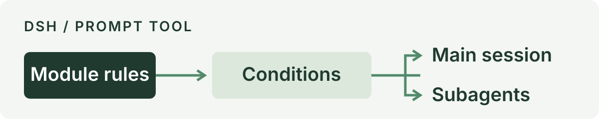

# dsh-plugin-prompt-tool

[中文](README.md) | English

Manage prompts and rules in [DeepSeek Harness (DSH)](https://deepseek-harness.github.io/deepseek-harness/). Use modules to choose what to inject, when to trigger it, and whether it applies to main sessions or subagents. Keep using your existing official session preset.



## What you can do

In the Prompt Tool workspace, you can:

- Edit prompts, personas, conditions, variables, and model parameters for main sessions and subagents
- Create, enable, disable, copy, and share modules; edit custom tools and tool permission rules
- Import SillyTavern presets, character cards, and world books as modules
- Configure ledgers, knowledge retrieval, and continuous memory in modules as needed; knowledge access and continuous memory require separate authorization

## Start using modules

After [installing the plugin](#install-the-plugin) below, open **Prompt Tool** from the sidebar:

1. The workspace opens on a shared canvas. Search for a module in the top-left picker. Select its name to browse its rules, or use the switch on the same row to enable or disable the module. Open **Module center** to create or import modules or change the global runtime switch.
2. The rule list defaults to participating modules and can also show all modules. Select a rule to see its owning module and rule name in the canvas header. **Enable rule** controls that rule alone. Use scope conditions and branches to express main-session and subagent actions within the same rule. The combination view also opens over the canvas.
3. Select a rule by name to open the canvas. The disclosure on its row shows its source and details. Search across the condition and action groups in the left library. Select an item to inspect it, then add it explicitly or drag it onto a target. Select a canvas node to see its name and parameters on the right.
4. Open **Module center**, search or filter the module cards, then open a module's rules directly from its card. Opening and editing do not enable modules. Rules load on demand; existing rule drafts provide counts and a short list. Expand diagnostics when needed; results with rule or action identities can take you back to that rule.

You can import [YAML](https://yaml.org/)/[JSON](https://www.json.org/json-en.html) module files, folders/[ZIP archives](https://pkware.cachefly.net/webdocs/casestudies/APPNOTE.TXT), SillyTavern presets, [PNG images](https://www.w3.org/TR/png/)/JSON character cards, and world books. New and imported modules start disabled. See [SillyTavern import details](docs/SillyTavern.md) for conversion limits.

For text injection, the inspector shows the text first and groups the content and placement settings. Select another node to switch inspectors, click empty canvas to dismiss the current panel, or drag to pan while keeping the node selected. Click the backdrop or press Escape to close Module center. If a module's enabled state is saved but publication fails, retry publication from another workspace entry point or Module center.

All three workspace entry points share browsing position and rule drafts in one layout. Template insertion preserves its declared audience; existing separate rules are never merged automatically. Opening or closing the module center does not automatically save rules. Wait for save confirmation before refreshing. In the terminal interface, use `/prompt-tool` to manage modules. The **Prompt Tool** section in `/settings` has the module runtime switch.

## Install the plugin

Requires DSH `0.2.2-rc.2` or later. For the command-line interface (CLI), you also need Node.js `24.9.0+` and pnpm on your PATH. See [package.json](package.json) for all requirements.

### Desktop or Web

Use the host’s plugin manager to install into your current profile:

1. Open **Plugins** in the sidebar and select **Add plugin**.
2. Enter `dsh-plugin-prompt-tool`, click **Install**, and follow the prompts to complete the checks and installation.
3. Select **Enable now** after installation. If the host requests a restart, restart the corresponding DSH application or service.

### CLI

These commands install into the `web` profile and start the Web interface:

```sh
dsh plugin --profile web add dsh-plugin-prompt-tool
dsh --profile web
```

For another CLI profile, replace `web` in both commands with its name. Restart that profile if it’s already running. For Desktop, use the plugin manager above. See the [official plugin guide](https://github.com/deepseek-ai/deepseek-harness/blob/master/docs/user/develop/basic/publish.md) for other installation options.

## Data and upgrades

Module definitions live in `$DSH_HOME/.prompt-tool/modules/<id>/module.yml`. Disabling a module removes its runtime contributions and preserves its definition and data. Exports exclude private `memory.md`, `data/`, and global variables.

After upgrading the plugin, restart the corresponding DSH application or service to load the new code. Upgrades preserve existing module definitions and private data. Update user copies explicitly to adopt newer built-in module settings. Old content modules remain installed, so review your enabled modules after upgrading.

For old module formats and data migration, see [format conversion](docs/architecture-params.md#旧格式与显式转换) and [asset transfer](docs/asset-transfer.md).

## Configure further

These reference documents are in Chinese:

| Task | Documentation |
| --- | --- |
| Write modules and find YAML examples | [Module authoring guide](skills/dsh-module/SKILL.md) · [Field reference](module.yml) |
| Configure variables, personas, and instruction policies | [Parameters and storage](docs/architecture-params.md) |
| Configure injection points, tools, and advanced actions | [Engine guide](docs/engine-reuse.md) · [Injection point contracts](docs/injection-point-contracts.md) |
| Import character cards and world books, or share modules | [SillyTavern conversion](docs/SillyTavern.md) · [Asset transfer](docs/asset-transfer.md) |

## Built-in modules

Enable, disable, or replace these modules as needed:

- **Ponytail**: Injects concise, pragmatic engineering rules with lite/full/ultra levels; sourced from [ponytail](https://github.com/DietrichGebert/ponytail).
- **Caveman**: Keeps technical facts while shortening replies, with caveman/ultracave/megacave levels; adapted from [caveman](https://github.com/JuliusBrussee/caveman).
- **PTC mode**: Presents tools as `run_code` and an SDK through the official executor.
- **Skill surface**: Hides the full skill catalog and uses `skill_search`/`skill_load` to find and load skills on demand.
- **Soul**: Provides criteria, structured ledgers, authorized retrieval, and a dynamic SELF for persistent identity; adapted from [dsh-agent-soul](https://github.com/cyanwell/dsh-agent-soul).
- **Tool surface**: Keeps core tools visible and unlocks others on demand through `tool_search`.

## Develop locally

Install dependencies and run checks from the repository directory. See [package.json](package.json) for Node.js and pnpm versions:

```sh
pnpm install --frozen-lockfile
pnpm typecheck
pnpm lint
pnpm test
pnpm build
git diff --check
```

For host integration or package changes, also run `pnpm verify:host` and `pnpm verify:pack`. After building, install locally through the DSH plugin manager using `link:` followed by the repository’s absolute path. Restart the host after code changes.

## Project status

The project is receiving updates; the latest release is [v6.1.0 (2026-11-17)](https://github.com/Czerror/dsh-plugin-prompt-tool/releases/tag/v6.1.0).

## License and sources

This project uses the [MIT license](LICENSE). Some capabilities draw on or adapt [dsh-anchored-standard](https://github.com/xiaobright/dsh-anchored-standard), [dsh-router-standard](https://github.com/yjh051108/dsh-router-standard), and [dsh-super-injector](https://github.com/yjh051108/dsh-super-injector). See [third-party licenses](engine/THIRD_PARTY_LICENSES) for copyright and license details.
