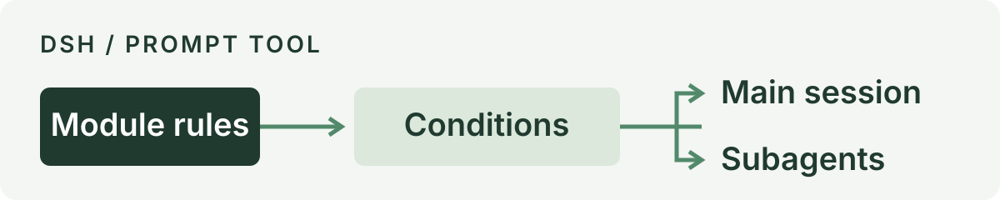

# dsh-plugin-prompt-tool

中文 | [English](README.en.md)

为 [DeepSeek Harness（DSH）](https://deepseek-harness.github.io/deepseek-harness/) 管理提示词与规则。用模块决定注入什么内容、何时触发，以及作用于主会话还是子代理；继续使用原有的官方会话预设。



## 能做什么

在提示词工具工作台中，你可以：

- 编辑提示词、人设、触发条件、变量和主会话／子代理的模型参数
- 新建、启停、复制和分享模块，编辑自定义工具与工具权限规则
- 导入 SillyTavern 预设、角色卡和世界书，转换为模块
- 在模块中按需配置账本、知识检索与持续记忆；知识库接入与持续记忆需另行授权

## 开始使用

完成下方[安装](#安装)后，从侧栏打开 **提示词工具**：

1. 在画布左上角点击 **模块**，按名称或 ID 搜索。点击卡片名称查看规则，卡片内的滑动开关决定模块是否参与运行。新建、导入和全局运行开关位于同一侧栏，改名、复制、导出等操作在卡片的“更多”中。
2. 在规则列表用 **参与中 / 全部** 切换模块范围，用下拉框筛选规则类型。点击行内规则名打开画布，用右侧 ↑、↓ 调整同一插入点与位置内的规则顺序。画布顶栏显示所属模块、规则名和保存状态，**启用规则** 只控制当前规则。主会话与子代理动作可通过同一规则的作用范围和分支表达。
3. 展开模块卡可从单行规则预览直接进入画布。左侧库按条件和动作分组，可跨组搜索。点库条目在右栏查看说明、选目标并添加，也可直接拖入合法目标。点击画布节点在同一右栏编辑；分支和条件组列出可直接打开的子节点。
4. 左上角的图标依次为 **模块、规则、动作条件库、隐藏、诊断**。选中规则后列表保持展开，可连续切换规则；点击 **隐藏** 可收起左栏。模块列表可按全部、已启用或已停用筛选。打开诊断侧栏，点击 **运行诊断** 读取记录。规则记录按模块展开，上下文记录按激活阶段展开。点击记录内的 **定位** 打开画布节点，再点顶栏的诊断图标回到原记录。

会话发现的每份指令文件（如 `AGENTS.md`、`CLAUDE.md`）各占一张独立画布卡。点击文件卡在右栏查看或编辑，点 **保存** 写回该文件。同行的路径提示开关控制全局指令路径提示。没有模块规则时也能使用文件卡。离开编辑器会尝试保存更改，磁盘版本冲突时保留草稿并提示重读。

导入支持 [YAML](https://yaml.org/)／[JSON](https://www.json.org/json-en.html) 模块文件、目录／[ZIP 压缩包](https://pkware.cachefly.net/webdocs/casestudies/APPNOTE.TXT)，以及 SillyTavern 预设、[PNG 图像](https://www.w3.org/TR/png/)／JSON 角色卡和世界书。新建和导入的模块默认不启用；SillyTavern 功能的转换范围见 [导入说明](docs/SillyTavern.md)。

右栏可编辑节点属性、指令文件和模块层设置，也可直接选择并编辑自定义工具。添加注入模板时，可在搜索对话框中选择模板和目标模块。轻点画布空白收起当前浮层，拖动画布保留选中节点。模块已保存但发布失败时，切换入口后仍可从模块侧栏重试发布。

窄屏初次显示可读的局部视角，底栏可适配全图。选中节点时，直接相连的线会沿方向短暂高亮。系统开启减少动态效果时使用静态高亮。

三个工作台入口共享浏览位置和规则草稿，不再分成主会话与子代理布局。模板插入保留模板自身受众，已有独立规则不会自动合并。收到保存确认后再刷新浏览器。终端界面可通过 `/prompt-tool` 操作模块，`/settings` 中的 **提示词工具** 提供模块运行总开关。

## 安装

最低支持 DSH `0.2.3-alpha.2`。CLI 需要 Node.js `^24.22.3 || >=26.13.1` 和 PATH 中可用的 pnpm。使用 DSH `0.2.2-rc.2` 的部署请保留插件 `6.3.1`。升级前请核对自定义模块的退役能力。[完整要求](package.json) · [升级说明](CHANGELOG.md)

从启用早期入口的部署升级时，请先从启动器的预加载参数中移除 `dsh-plugin-prompt-tool/early`，再按正常流程启动 DSH。插件管理器继续装配普通入口。被退役字段会在保存校验或规则诊断中指出规则与字段，按[宿主控制动作](docs/subsystems/engine-host-controls.md)核对适用行为。

### 桌面端或 Web

通过宿主的插件管理页安装到当前使用的配置环境（profile）：

1. 打开侧栏的 **插件**，选择 **添加插件**。
2. 输入 `dsh-plugin-prompt-tool`，点击 **安装**，按提示完成检查与安装。
3. 安装完成后选择 **立即启用**；若宿主提示需要重启，重启对应的 DSH 应用或服务。

### CLI

以下命令安装到 `web` profile，然后启动 Web 界面：

```sh
dsh plugin --profile web add dsh-plugin-prompt-tool
dsh --profile web
```

已有其他 CLI profile 时，把两处 `web` 换为它的名称。若该 profile 正在运行，安装后重启它。桌面端使用上面的插件管理页。更多安装方式见 [官方插件指南](https://github.com/deepseek-ai/deepseek-harness/blob/master/docs/user/develop/basic/publish.zh.md)。

## 数据与升级

已安装模块保存在 `$DSH_HOME/.prompt-tool/modules/<id>/`，在工作台或模块工具中编辑。安装和导出使用完整的 `module.yml`。停用模块会撤回运行贡献，并保留本地提交和数据。分享导出排除私有 `memory.md`、`data/` 和全局变量。跨版本迁移见[升级与降级](docs/asset-transfer.md#升级与降级)。

升级插件后，重启对应的 DSH 应用或服务以加载新代码。升级不会覆盖已有模块定义或私有数据；需要新版内置模块配置时，请显式更新用户副本。旧版内容模块也不会自动移除，升级后请检查已启用的模块。

旧模块格式的转换与数据迁移见 [旧格式转换](docs/subsystems/params-migration.md#旧格式与显式转换) 和 [资产交换](docs/asset-transfer.md)。

## 进一步配置

按需查阅对应文档：

| 任务 | 文档 |
| --- | --- |
| 编写模块、查看 YAML 示例 | [模块编写指南](skills/dsh-module/SKILL.md) · [字段参考](module.yml) |
| 配置变量、人设与指令策略 | [变量与模板](docs/subsystems/variables.md) · [人设与指令策略](docs/subsystems/params-editors.md) |
| 配置注入位置、工具与高级动作 | [引擎指南](docs/engine-reuse.md) · [插入点契约](docs/injection-point-contracts.md) |
| 导入角色卡、世界书或分享模块 | [SillyTavern 转换](docs/SillyTavern.md) · [资产交换](docs/asset-transfer.md) |

## 内置模块

内置模块可按需启停或替换：

- **Ponytail**：注入精简务实的工程规则，提供 lite／full／ultra 三档；来源 [ponytail](https://github.com/DietrichGebert/ponytail)。
- **Caveman**：保留技术事实，精简回答表达，提供普通／极简／文言三档；改编自 [caveman](https://github.com/JuliusBrussee/caveman)。
- **PTC 模式**：通过官方执行器将工具呈现为 `run_code` 与 SDK。
- **技能面收窄**：隐藏完整技能目录，通过 `skill_search`／`skill_load` 按需查找和加载。
- **Soul**：提供判据、结构化账本、授权检索与动态 SELF 等持续身份能力；改编自 [dsh-agent-soul](https://github.com/cyanwell/dsh-agent-soul)。
- **工具面收窄**：保留核心工具，其余通过 `tool_search` 按需解锁。

## 本地开发

要复现发布检查，在干净的 Windows 工作区使用与 [GitHub Actions](.github/actions/setup/action.yml) 相同的 Node.js 版本和 [package.json](package.json) 中 `packageManager` 指定的 pnpm，运行以下命令。

```sh
pnpm install --frozen-lockfile
pnpm run verify:ci
git diff --check
```

`verify:ci` 依次执行类型检查、lint、含构建的完整测试、宿主契约和打包安装验证。提交到 `dev` 或 `main` 的 PR 会在 Windows runner 上执行同一入口；发布标签在 npm 发布前再验证一次。

构建后可在 DSH 插件管理页用 `link:` 加仓库绝对路径安装本地版本；更新代码后重启宿主。

## 项目状态

项目持续更新；最近发布为 [v6.1.0（2026-11-17）](https://github.com/Czerror/dsh-plugin-prompt-tool/releases/tag/v6.1.0)。

## 许可与来源

本项目采用 [MIT 许可](LICENSE)。部分能力参考或移植自 [dsh-anchored-standard](https://github.com/xiaobright/dsh-anchored-standard)、[dsh-router-standard](https://github.com/yjh051108/dsh-router-standard) 和 [dsh-super-injector](https://github.com/yjh051108/dsh-super-injector)；版权与许可见 [第三方许可](engine/THIRD_PARTY_LICENSES)。
